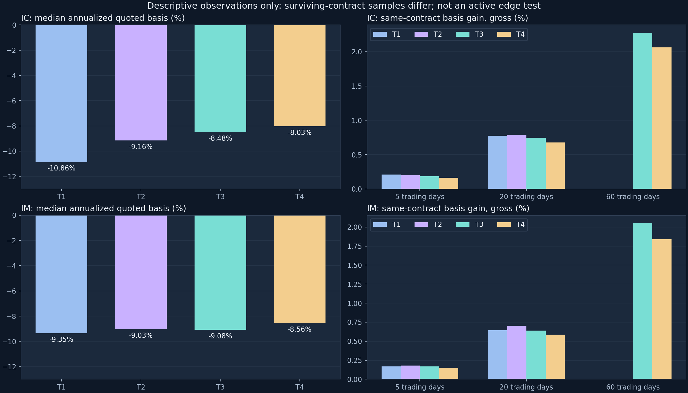
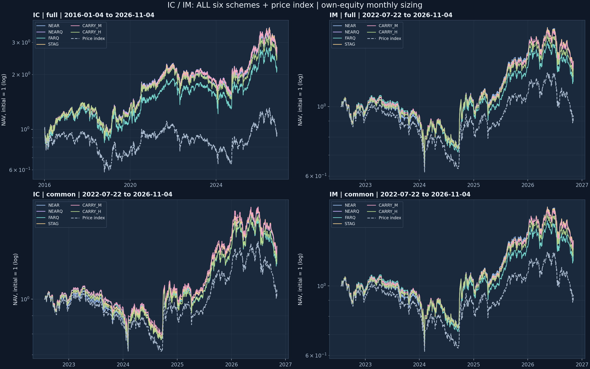

# IC / IM 基差与期限配置：更新到 2026-11-04 的固定规则复跑

> **公开版说明（包版本 1.0.0）**：本文是创作环境的一次真实运行报告（样本截至 **2026-11-04**，
> 24 组固定回放全部通过），随包发布。公开版只做了三件事：把图片与证据表链接改到随包实际
> 路径、把逐日流水与原始行情改为“由使用者自备输入复跑生成”、补上包与验证入口。研究口径、
> 结果、弱表现与限制文字未改。
>
> - 本包实测（从实际构建的 ZIP 解压目录运行）：[`PACKAGE_VALIDATION.md`](PACKAGE_VALIDATION.md)
> - 早前在已安装 Skill 上的原生复用验证：[`verification-20261105/SKILL_VERIFICATION.md`](verification-20261105/SKILL_VERIFICATION.md)
> - 复跑步骤与验收：[`../references/ic-im-example.md`](../references/ic-im-example.md)、[`../README.md`](../README.md)
> - 统一比较表：[`evidence/comparison.csv`](evidence/comparison.csv)；机器检查：[`evidence/checks.json`](evidence/checks.json)

> **结论：把样本推进到 2026-11-04（新增 1 个共同交易日）之后，full 窗口 IC、full 窗口 IM、common 窗口 IM 的排序未变；只有 common 窗口 IC 出现轻微换位——STAG 相对 CARRY_M 由 +0.0209 变为 -0.0009 个百分点/年（新样本 STAG 8.6392%、CARRY_M 8.6401%，差距不足 0.001 个百分点/年）——这个量级的换位不构成稳定优势。**
> **长期多头期货相对各自价格指数的超额仍为正，两条冻结的主动选期规则仍没有证明能增加扣费后优势。**
> 本轮只做一件事：取运行时实际可取得的最新完整收盘，按原冻结规则一次性重放 24 组，不做参数扫描、不改门槛、不新增规则。这是**收盘机制投影**，不是实盘业绩。

## 1. 数据截止日与"较旧样本实际新增了什么"

- 客户端时钟：**2026-11-05 10:46（CST，Asia/Shanghai）**，仍在当日早盘交易时段内。
- 最新共同完整收盘交易日：**2026-11-04**（期货当日结算价已生成、对应价格指数当日收盘已发布）。
- 较旧样本（原课题保存结果止于 **2026-11-03**）实际新增：**1 个交易日**（2026-11-04）。这是本次唯一可取得的增量，没有把更早的历史重拉一遍。
- 2026-11-05 的行情**不进入样本**：8 个合约当日的结算价（settlement）全部为空，说明当日会话尚未结束；指数当日只有盘中打印、没有收盘价。

### 1.1 各数据源的实际覆盖、状态与缺口

| 数据源 | 实际最大日期 | 状态 | 本次用法 |
| --- | --- | --- | --- |
| 本机行情湖（原课题 panel，只读） | 2026-11-03 | 已保存快照，本次未刷新 | 作为 2016-01-04..2026-11-03 的基础样本 |
| PandaData `get_future_daily`（8 个挂牌合约） | 2026-11-04 | 当日结算价齐全，判定为完整 | 新增日期货 close / volume / open_interest |
| PandaData `get_index_daily`（000905.SH、000852.SH） | 2026-11-04 | 当日收盘齐全，判定为完整 | 新增日指数 close |
| PandaData（2026-11-05） | 2026-11-05 | 不完整：期货结算价（settlement）全为空；指数当日成交量仅为前一日的 53.6%（000905）、52.5%（000852） | **排除**，不用盘中价当收盘 |
| SH 交易日历（原课题文件） | 2026-12-31 | 复制未修改（已覆盖到 2026-12-31） | 到期保护 DTE 计算 |

### 1.2 拼接这一步的机械核对（不是口头声明）

- 期货重叠核对（2026-11-03）：新源与本地行情湖在 2026-11-03 的 8 个合约上**收盘价与持仓量逐一完全相等**（`all_futures_close_and_oi_equal=True`）。期货快照从 2026-11-03 起取，因此期货只有 2026-11-03 一个重叠日。
- 指数重叠核对（2026-11-02、2026-11-03）：000905.SH 与 000852.SH 在这两个交易日的收盘价与本地行情湖完全相等（`all_index_close_equal=True`）。指数快照从 2026-11-02 起取，因此指数有两个重叠日。
- 唯一差异：2026-11-03 这 8 个合约的成交量，新源比本地行情湖高 0.02%~0.19%。成交量在本研究中只作为"大于 0"的流动性门槛，且主动规则候选要求 volume>0，因此该口径差不进入损益、仓位定量与基差计算。
- 面板完整性：IC 2631 个交易日、IM 1038 个交易日，与 SH 日历逐一比对**缺失 0 天**；每个交易日恒为 4 个挂牌合约。两只指数同样 0 缺口。
- 新增日的挂牌集合按 CFFEX 规则（当月+下月+随后两个季月）核对，观察到的 8 个合约与之完全一致：IC IC2611, IC2612, IC2703, IC2706；IM IM2611, IM2612, IM2703, IM2706。全部是样本中已有的合约，**不需要重新推导到期日**，也没有新合约上市带来的替换。
- 到期映射与交易日历原样复制、未修改；2015 段 IC 未补取，不在本轮范围。

## 2. 数据方法与组件复用

沿用原课题的账户核算与选约实现，本轮**没有重写引擎、策略、指标或统计**：

| 用途 | 复用入口 | 本轮处理 |
| --- | --- | --- |
| 真实成交腿损益、逐腿费用、权益、保证金 | `06_engine.py::Portfolio.step_day`（经 08 调用） | 原样导入 |
| 账户循环、资金时钟、四被动方案、选择器接口 | `08_passive_baseline.py::run_scheme` | 原样导入，仅改基础目录 |
| 账户恒等式/持仓/到期/数量/费用检查 | `08_passive_baseline.py::verify` | 原样调用，未放宽容差 |
| 两条冻结主动规则与选约 fixture | `16_active_rules.py::CarrySelector` / `selftest` | 原样导入，门槛未动 |
| 逐日目标执行、总 q 守恒、逐腿价格与费用、换月审计、观察表 | `17_active_comparison.py` 的辅助函数 | 原样导入 |
| 年化、夏普/回撤、相对指数超额 | `qs_metrics_adapter.py` → 已装 Tearsheet 技能 `metrics.py` | 原样调用（含原两处修正） |
| 峰值/谷底/收复等待 | 同上 `drawdown_table_fixed` | 原样调用 |
| 单合约序列结构审计 | 已装 `futures-roll-auditor` `audit_rolls.analyze(none)` | 原样调用，告警保留 |
| 基差面板、前瞻 5/20/60、条件分组 | `13_basis_panel.py`、`14_forward_outcomes.py`、`15_conditional.py` | 以新目录重绑定后执行 |
| 对数净值图、统一 CSV | `18_active_report.py::figures/consolidated_csv` | 原样调用（不运行其 `main`） |

本轮新增的薄适配只有三处（全部在新目录，未改安装源与原课题）：

1. `code/01_update_inputs.py`：把最新完整交易日拼进 `tenor_map_daily.csv` 与 `spot_daily.parquet` 的副本，并做上节的完整性/重叠核对；`code/00_env_check.py` 记录解释器与组件绑定。
2. 路径重绑定：`08.DIR/ART`、`17.ART/OUT`、`07.ART`、`18.ROOT/ART/DATA/FIG` 指向本目录；`13/14/15` 以文本方式把其唯一的基础目录常量改到本目录后**原样执行**。
3. 一处验收口径调整：原 17 要求"四被动全样本逐日权益与已保存结果完全一致且日期索引相同"，新样本多了 1 天，因此改为**在重叠前缀上逐日比对**，并把新增日单独列出。不改这条检查的容差（仍是 1e-6 元绝对值），也不放弃检查。
4. 一处复跑判据修正（本轮发现并修正）：`03_run_comparison.run_fixture()` 原来用"产物文件在本次运行前不存在"来判定 fixture 是否真的跑过，因此在**同一目录复跑必然失败，与核算结果无关**。现改为"本次运行确实重写了该文件（mtime 变化）且每个子用例 pass"，并在函数内把 fixture 的输出目录绑定到本目录。核算、规则、门槛一字未改。

发布包（1.0.0）在此基础上又做了发布所需的路径适配，逐文件说明见
[`../docs/package-changes.md`](../docs/package-changes.md)：基础目录改由 `scripts/qs_paths.py`
解析（`--inputs`/`--out`）；三个外部组件的 `scripts` 目录改为按 `--components` “唯一版本或
显式固定版本”解析；原 `08.main()`（64 组组合）与 `18.main()`（写固定结论文案并重新打包）未随
包发布；原“与已保存被动逐日结果比对”改为可选的 `--results` 参照回归（未提供时明确记为
`not_run`）。财务计算、方案定义、检查与统计未改。

冻结口径未变：IC/IM 对应价格指数、300 万元初始资本、乘数 200、单边 2bp、现金利息 0、月末按各方案自身权益 `q=E/(200×S)` 复投、下一交易日收盘执行、期间主动换月只改期限配置。六方案仍是 NEAR / NEARQ / FARQ / STAG / CARRY_M / CARRY_H，门槛一字未改。

## 3. 四期限基差观察（更新后）

`basis=F−S`（负值为贴水），简单年化 `(F−S)/S×365/日历日`；到期当日年化无定义，共 181 行不填造。

| 品种 | 挂牌顺位 | F<S 日占比 | 年化报价基差中位数 |
| --- | --- | --- | --- |
| IC | T1 | 82.33% | -10.86% |
| IC | T2 | 93.73% | -9.16% |
| IC | T3 | 97.68% | -8.48% |
| IC | T4 | 99.28% | -8.03% |
| IM | T1 | 79.67% | -9.35% |
| IM | T2 | 95.38% | -9.03% |
| IM | T3 | 98.84% | -9.08% |
| IM | T4 | 99.90% | -8.56% |

新增一天的基差状态（2026-11-04，指数当日大涨后近端贴水明显收窄）：

| 品种 | 合约 | 顺位 | 基差(点) | 基差率 | 年化报价基差 | 剩余日历日 |
| --- | --- | --- | --- | --- | --- | --- |
| IC | IC2611 | T1 | -12.6 | -0.19% | -4.35% | 16 |
| IC | IC2612 | T2 | -43.2 | -0.65% | -5.42% | 44 |
| IC | IC2703 | T3 | -176.2 | -2.66% | -7.20% | 135 |
| IC | IC2706 | T4 | -331.2 | -5.00% | -8.08% | 226 |
| IM | IM2611 | T1 | -6.4 | -0.10% | -2.24% | 16 |
| IM | IM2612 | T2 | -42.6 | -0.65% | -5.43% | 44 |
| IM | IM2703 | T3 | -185.6 | -2.85% | -7.71% | 135 |
| IM | IM2706 | T4 | -346.2 | -5.32% | -8.59% | 226 |

对照上表的历史中位数：IC 的 T1 年化 −10.86%、IM 的 T1 −9.35%，而新增当日 IC2611 只有 −4.35%、IM2611 只有 −2.24%。**这是单日状态，不是均值回归证据**，也不作为任何规则输入。

### 3.1 同合约 5/20/60 交易日观察（毛值，不含续滚）

`conv_h = [(F_{t+h}−F_t)−(S_{t+h}−S_t)]/S_t`，正数表示该同合约持有期内基差变化给多头带来相对指数的增益。

| 品种 | 观察尺度(交易日) | 期初顺位 | 有效同合约样本 | 平均基差增益(毛) | 正增益占比 |
| --- | --- | --- | --- | --- | --- |
| IC | 5 | T1 | 1846 | 0.21% | 71.51% |
| IC | 5 | T2 | 2626 | 0.20% | 68.66% |
| IC | 5 | T3 | 2626 | 0.19% | 63.10% |
| IC | 5 | T4 | 2626 | 0.16% | 59.63% |
| IC | 20 | T1 | 115 | 0.77% | 87.83% |
| IC | 20 | T2 | 2395 | 0.79% | 86.22% |
| IC | 20 | T3 | 2611 | 0.74% | 79.89% |
| IC | 20 | T4 | 2611 | 0.68% | 72.31% |
| IC | 60 | T3 | 1718 | 2.27% | 93.89% |
| IC | 60 | T4 | 2571 | 2.06% | 87.13% |
| IM | 5 | T1 | 727 | 0.17% | 67.95% |
| IM | 5 | T2 | 1033 | 0.18% | 66.60% |
| IM | 5 | T3 | 1033 | 0.17% | 62.83% |
| IM | 5 | T4 | 1033 | 0.15% | 60.12% |
| IM | 20 | T1 | 41 | 0.64% | 80.49% |
| IM | 20 | T2 | 931 | 0.71% | 85.61% |
| IM | 20 | T3 | 1018 | 0.64% | 77.21% |
| IM | 20 | T4 | 1018 | 0.58% | 70.33% |
| IM | 60 | T3 | 653 | 2.05% | 93.26% |
| IM | 60 | T4 | 978 | 1.84% | 88.55% |

**样本选择限制照旧**：只有期末同合约仍存续、未到期才有该观察。T1 的 20 日样本 IC 仅 115 条、IM 仅 41 条；T1/T2 的 60 日无有效同合约样本。缺样是这张表的范围，不是近月配置不能研究长尺度——下面的真实续滚账户覆盖了这些尺度。

### 3.2 同日起讫配对比较

| 品种 | 尺度 | 同日配对 | 样本数 | 远端−近端平均差(pp) | 差额为正占比 |
| --- | --- | --- | --- | --- | --- |
| IC | 5 | T4_minus_T1 | 1846 | -0.082 | 41.82% |
| IC | 5 | T4_minus_T2 | 2626 | -0.037 | 45.39% |
| IC | 5 | T4_minus_T3 | 2626 | -0.024 | 44.97% |
| IC | 20 | T4_minus_T1 | 115 | -0.105 | 42.61% |
| IC | 20 | T4_minus_T2 | 2395 | -0.125 | 42.46% |
| IC | 20 | T4_minus_T3 | 2611 | -0.069 | 42.21% |
| IC | 60 | T4_minus_T1 | 0 | — | — |
| IC | 60 | T4_minus_T2 | 0 | — | — |
| IC | 60 | T4_minus_T3 | 1718 | -0.189 | 40.86% |
| IM | 5 | T4_minus_T1 | 727 | -0.078 | 39.06% |
| IM | 5 | T4_minus_T2 | 1033 | -0.029 | 44.34% |
| IM | 5 | T4_minus_T3 | 1033 | -0.019 | 42.79% |
| IM | 20 | T4_minus_T1 | 41 | -0.600 | 19.51% |
| IM | 20 | T4_minus_T2 | 931 | -0.154 | 39.85% |
| IM | 20 | T4_minus_T3 | 1018 | -0.057 | 38.31% |
| IM | 60 | T4_minus_T1 | 0 | — | — |
| IM | 60 | T4_minus_T2 | 0 | — | — |
| IM | 60 | T4_minus_T3 | 653 | -0.233 | 37.06% |

远端并没有因为点数贴水更深就自动胜出：5 日同日配对 T4−T1 平均差 IC/IM 均为 −0.08 个百分点，60 日 T4−T3 仍为负。这仍是有存续条件的毛值观察，不是次日执行的规则净收益。

### 3.3 历史排名分组（线索不等于择期优势）

| 品种 | 历史年化贴水排名分组(0=更深贴水) | 合约日数 | 20日基差增益(%) | 为正占比(%) |
| --- | --- | --- | --- | --- |
| IC | 0 | 1933 | 1.278 | 92.45 |
| IC | 1 | 1933 | 0.819 | 85.05 |
| IC | 2 | 1933 | 0.625 | 80.34 |
| IC | 3 | 1933 | 0.221 | 59.80 |
| IM | 0 | 752 | 1.333 | 94.68 |
| IM | 1 | 752 | 0.782 | 84.31 |
| IM | 2 | 753 | 0.348 | 71.58 |
| IM | 3 | 751 | 0.106 | 59.52 |

更深贴水排名组的后续基差增益较高，但分组混合不同时点与期限，且 20 日有存续筛选；分组边界来自样本描述，**不作为可交易信号阈值**。OI/波动分组仍无跨品种一致单调关系，本轮未据此再叠过滤器。



## 4. 六方案统一结果（全部保留）

评价只用四件事：相对对应价格指数的年化超额、账户回撤、谷底至修复、费用与单边换手。年化 252 交易日；**年化超额 = 账户 CAGR − 对应价格指数 CAGR**。

### 4.1 各品种完整可用样本

| 品种 | 方案 | 净年化 | 对指数超额(pp/年) | 对NEARQ差(pp/年) | 账户最大回撤 | 谷底至修复(交易日) | 费用(万元) | 年化单边换手(倍) |
| --- | --- | --- | --- | --- | --- | --- | --- | --- |
| IC | NEAR | 9.96% | +10.334 | -0.484 | -37.29% | 352 | 26.96 | 24.9 |
| IC | NEARQ | 10.44% | +10.818 | +0.000 | -36.02% | 350 | 9.18 | 8.3 |
| IC | FARQ | 7.77% | +8.152 | -2.667 | -37.46% | 415 | 7.68 | 8.2 |
| IC | STAG | 10.36% | +10.740 | -0.079 | -35.96% | 349 | 9.09 | 8.3 |
| IC | CARRY_M | 10.14% | +10.515 | -0.304 | -36.23% | 325 | 28.49 | 26.3 |
| IC | CARRY_H | 9.34% | +9.721 | -1.097 | -37.17% | 365 | 118.96 | 112.6 |
| IM | NEAR | 8.11% | +9.672 | -0.327 | -39.42% | 179 | 6.97 | 25.0 |
| IM | NEARQ | 8.43% | +10.000 | +0.000 | -39.95% | 179 | 2.37 | 8.5 |
| IM | FARQ | 5.75% | +7.313 | -2.687 | -40.60% | 343 | 2.19 | 8.2 |
| IM | STAG | 8.43% | +9.992 | -0.008 | -40.00% | 179 | 2.36 | 8.5 |
| IM | CARRY_M | 8.21% | +9.780 | -0.220 | -38.48% | 179 | 7.63 | 27.9 |
| IM | CARRY_H | 7.01% | +8.573 | -1.427 | -38.30% | 179 | 34.43 | 124.3 |

同期对应价格指数年化：IC -0.38%、IM -1.57%（`bench_cagr` 列）。

### 4.2 共同区间（两者重新从 300 万元起算）

| 品种 | 方案 | 净年化 | 对指数超额(pp/年) | 对NEARQ差(pp/年) | 账户最大回撤 | 谷底至修复(交易日) | 费用(万元) | 年化单边换手(倍) |
| --- | --- | --- | --- | --- | --- | --- | --- | --- |
| IC | NEAR | 8.21% | +6.718 | -0.363 | -31.06% | 157 | 6.99 | 25.0 |
| IC | NEARQ | 8.57% | +7.082 | +0.000 | -31.69% | 177 | 2.39 | 8.5 |
| IC | FARQ | 6.86% | +5.368 | -1.714 | -32.70% | 179 | 2.28 | 8.3 |
| IC | STAG | 8.64% | +7.150 | +0.068 | -31.68% | 157 | 2.38 | 8.5 |
| IC | CARRY_M | 8.64% | +7.151 | +0.069 | -30.73% | 157 | 7.43 | 25.6 |
| IC | CARRY_H | 7.29% | +5.804 | -1.277 | -32.46% | 181 | 30.51 | 109.5 |
| IM | NEAR | 8.11% | +9.672 | -0.327 | -39.42% | 179 | 6.97 | 25.0 |
| IM | NEARQ | 8.43% | +10.000 | +0.000 | -39.95% | 179 | 2.37 | 8.5 |
| IM | FARQ | 5.75% | +7.313 | -2.687 | -40.60% | 343 | 2.19 | 8.2 |
| IM | STAG | 8.43% | +9.992 | -0.008 | -40.00% | 179 | 2.36 | 8.5 |
| IM | CARRY_M | 8.21% | +9.780 | -0.220 | -38.48% | 179 | 7.63 | 27.9 |
| IM | CARRY_H | 7.01% | +8.573 | -1.427 | -38.30% | 179 | 34.43 | 124.3 |

不把老 IC 权益截片当新账户；IM 共同区间与其全样本相同，因此结果一致。



四个 panel 都画出了全部六方案与对应价格指数，没有隐藏弱方案；指数在策略建仓日之前及当日为 1，此后按价格指数变动，消除首日空仓错位。

### 4.3 这一天的增量到底改变了什么

同一份代码、同一个引擎，只把最后一天从 2026-11-03 推到 2026-11-04：

| 品种 | 方案 | 原样本净年化(至 11-03) | 新样本净年化(至 11-04) | 变化 | 原对NEARQ差 | 新对NEARQ差 |
| --- | --- | --- | --- | --- | --- | --- |
| IC | NEAR | 9.49% | 9.96% | +0.470 | -0.479 | -0.484 |
| IC | NEARQ | 9.96% | 10.44% | +0.475 | +0.000 | +0.000 |
| IC | FARQ | 7.30% | 7.77% | +0.473 | -2.665 | -2.667 |
| IC | STAG | 9.89% | 10.36% | +0.474 | -0.079 | -0.079 |
| IC | CARRY_M | 9.65% | 10.14% | +0.482 | -0.311 | -0.304 |
| IC | CARRY_H | 8.86% | 9.34% | +0.479 | -1.101 | -1.097 |
| IM | NEAR | 6.94% | 8.11% | +1.168 | -0.293 | -0.327 |
| IM | NEARQ | 7.23% | 8.43% | +1.202 | +0.000 | +0.000 |
| IM | FARQ | 4.54% | 5.75% | +1.204 | -2.688 | -2.687 |
| IM | STAG | 7.22% | 8.43% | +1.202 | -0.008 | -0.008 |
| IM | CARRY_M | 6.98% | 8.21% | +1.230 | -0.247 | -0.220 |
| IM | CARRY_H | 5.79% | 7.01% | +1.218 | -1.442 | -1.427 |

读法：新增的一天是大幅上涨日（000905 +4.66%、000852 +4.67%），贴水合约的当日涨幅更大，因此所有方案的年化都上移（IC 全样本约 +0.47pp、IM 约 +1.17~1.20pp；共同区间 IC 约 +1.17~1.21pp）。排序上，full 窗口 IC、full 窗口 IM、common 窗口 IM 均未变（NEARQ/STAG 在前、FARQ 最弱、CARRY_H 落后 NEARQ）；**只有 common 窗口 IC 的 STAG 与 CARRY_M 换位**：STAG 相对 CARRY_M 由 +0.0209 变为 -0.0009 个百分点/年（8.6392% vs 8.6401%），量级不足 0.001 个百分点/年，**不能称为主动规则的稳定优势**。不应把这一天当成对任何规则的验证或否定。

| 品种 | 方案 | 2026年对指数超额(旧) | 2026年对指数超额(新) | 变化 |
| --- | --- | --- | --- | --- |
| IC | NEAR | +5.78 | +6.00 | +0.221 |
| IC | NEARQ | +7.30 | +7.61 | +0.317 |
| IC | FARQ | +5.98 | +6.32 | +0.336 |
| IC | STAG | +7.36 | +7.68 | +0.320 |
| IC | CARRY_M | +5.60 | +5.92 | +0.318 |
| IC | CARRY_H | +7.18 | +7.57 | +0.389 |
| IM | NEAR | +7.20 | +7.47 | +0.273 |
| IM | NEARQ | +9.30 | +9.78 | +0.483 |
| IM | FARQ | +8.38 | +8.93 | +0.548 |
| IM | STAG | +9.32 | +9.80 | +0.484 |
| IM | CARRY_M | +9.01 | +9.59 | +0.578 |
| IM | CARRY_H | +7.19 | +7.69 | +0.492 |

## 5. 5/20/60 日：真实续滚后的条件比较

从每个共同日期 t 把**已经回放的账户**继续到 t+h，含真实续滚、月末复投与期间费用。它不是每个窗口重新开户，也不是强制在第 h 日退出；近月到期不会删除 20/60 日窗口。

`near_carry_ge_far`：期初 T1 年化 carry 不低于 T4；`far_carry_gt_near` 反之。

| 品种 | 尺度 | 真实续滚账户差 | 期初曲线条件 | 窗口数 | 平均收益差(pp) | 胜出占比 |
| --- | --- | --- | --- | --- | --- | --- |
| IC | 5 | far_minus_near | near_carry_ge_far | 1596 | -0.094 | 41.67% |
| IC | 5 | far_minus_near | far_carry_gt_near | 900 | +0.054 | 56.89% |
| IC | 5 | staged_minus_nearq | near_carry_ge_far | 1596 | -0.002 | 50.19% |
| IC | 5 | staged_minus_nearq | far_carry_gt_near | 900 | -0.000 | 52.22% |
| IC | 20 | far_minus_near | near_carry_ge_far | 1589 | -0.217 | 38.51% |
| IC | 20 | far_minus_near | far_carry_gt_near | 893 | +0.032 | 53.08% |
| IC | 20 | staged_minus_nearq | near_carry_ge_far | 1589 | -0.010 | 51.10% |
| IC | 20 | staged_minus_nearq | far_carry_gt_near | 893 | +0.001 | 53.53% |
| IC | 60 | far_minus_near | near_carry_ge_far | 1566 | -0.424 | 38.76% |
| IC | 60 | far_minus_near | far_carry_gt_near | 878 | -0.329 | 41.80% |
| IC | 60 | staged_minus_nearq | near_carry_ge_far | 1566 | -0.032 | 40.87% |
| IC | 60 | staged_minus_nearq | far_carry_gt_near | 878 | +0.009 | 56.95% |
| IM | 5 | far_minus_near | near_carry_ge_far | 545 | -0.099 | 38.53% |
| IM | 5 | far_minus_near | far_carry_gt_near | 437 | +0.015 | 52.40% |
| IM | 5 | staged_minus_nearq | near_carry_ge_far | 545 | -0.000 | 45.50% |
| IM | 5 | staged_minus_nearq | far_carry_gt_near | 437 | -0.000 | 47.83% |
| IM | 20 | far_minus_near | near_carry_ge_far | 542 | -0.303 | 33.39% |
| IM | 20 | far_minus_near | far_carry_gt_near | 426 | -0.045 | 47.89% |
| IM | 20 | staged_minus_nearq | near_carry_ge_far | 542 | +0.000 | 42.80% |
| IM | 20 | staged_minus_nearq | far_carry_gt_near | 426 | -0.003 | 43.43% |
| IM | 60 | far_minus_near | near_carry_ge_far | 525 | -0.774 | 36.19% |
| IM | 60 | far_minus_near | far_carry_gt_near | 405 | -0.482 | 44.20% |
| IM | 60 | staged_minus_nearq | near_carry_ge_far | 525 | -0.000 | 44.00% |
| IM | 60 | staged_minus_nearq | far_carry_gt_near | 405 | -0.007 | 37.28% |

同一结论在本样本仍在：换远的条件性线索很短（`far_carry_gt_near` 时 5 日差 IC +0.05、IM +0.02 个百分点，20 日 IC 仍略正、IM 转负，60 日两者皆负）；分批与整笔差距接近 0 且符号不稳。

两条主动规则在各观察尺度的真实续滚表现：

| 品种 | 尺度 | 主动−NEARQ | 窗口数 | 平均收益差(pp) | 胜出占比 |
| --- | --- | --- | --- | --- | --- |
| IC | 5 | CARRY_M_minus_NEARQ | 2626 | -0.007 | 50.04% |
| IC | 5 | CARRY_H_minus_NEARQ | 2626 | -0.021 | 44.55% |
| IC | 20 | CARRY_M_minus_NEARQ | 2611 | -0.037 | 49.79% |
| IC | 20 | CARRY_H_minus_NEARQ | 2611 | -0.092 | 39.75% |
| IC | 60 | CARRY_M_minus_NEARQ | 2571 | -0.113 | 44.11% |
| IC | 60 | CARRY_H_minus_NEARQ | 2571 | -0.287 | 33.92% |
| IM | 5 | CARRY_M_minus_NEARQ | 1033 | -0.005 | 48.89% |
| IM | 5 | CARRY_H_minus_NEARQ | 1033 | -0.029 | 42.30% |
| IM | 20 | CARRY_M_minus_NEARQ | 1018 | -0.022 | 45.58% |
| IM | 20 | CARRY_H_minus_NEARQ | 1018 | -0.121 | 37.43% |
| IM | 60 | CARRY_M_minus_NEARQ | 978 | -0.090 | 48.06% |
| IM | 60 | CARRY_H_minus_NEARQ | 978 | -0.373 | 34.56% |

两条规则在 5/20/60 日对 NEARQ 的无条件平均差**全部为负**，成本门槛规则尤其弱。深贴水分组里的正基差增益并没有自动转化为择期后的净新增优势。

### 5.1 新末端尚未成熟的前瞻窗口（不补造结果）

| 品种 | 尺度(交易日) | 最后一个能观察完整窗口的决策日 | 末端不足窗口的日期数 |
| --- | --- | --- | --- |
| IC | 5 | 2026-10-28 | 5 |
| IC | 20 | 2026-09-30 | 20 |
| IC | 60 | 2026-08-04 | 60 |
| IM | 5 | 2026-10-28 | 5 |
| IM | 20 | 2026-09-30 | 20 |
| IM | 60 | 2026-08-04 | 60 |

这些末端日期仍进入账户回放与统一比较表（它们的持有损益是真实的），只是**还不具备"此后 h 日的完整前瞻观察"**，因此不参与条件窗口统计，也不外推。

## 6. 回撤、恢复、成本与换手

| 品种 | 方案 | 账户峰值 | 谷底 | 收复日 | 谷底后等待(td) | 水下总长(td) | 账户未恢复 | 未恢复等待(td) |
| --- | --- | --- | --- | --- | --- | --- | --- | --- |
| IC | NEAR | 2021-09-10 | 2024-02-05 | 2025-07-24 | 352 | 934 | False | 0 |
| IC | NEARQ | 2022-01-04 | 2024-02-05 | 2025-07-22 | 350 | 858 | False | 0 |
| IC | FARQ | 2017-10-10 | 2018-10-18 | 2020-07-03 | 415 | 665 | False | 0 |
| IC | STAG | 2022-01-04 | 2024-02-05 | 2025-07-21 | 349 | 857 | False | 0 |
| IC | CARRY_M | 2017-10-13 | 2018-10-18 | 2020-02-20 | 325 | 572 | False | 0 |
| IC | CARRY_H | 2022-01-04 | 2024-02-05 | 2025-08-12 | 365 | 873 | False | 0 |
| IM | NEAR | 2022-08-18 | 2024-02-05 | 2024-11-07 | 179 | 536 | False | 0 |
| IM | NEARQ | 2023-04-07 | 2024-02-05 | 2024-11-07 | 179 | 383 | False | 0 |
| IM | FARQ | 2023-04-17 | 2024-02-05 | 2025-07-11 | 343 | 541 | False | 0 |
| IM | STAG | 2023-04-07 | 2024-02-05 | 2024-11-07 | 179 | 383 | False | 0 |
| IM | CARRY_M | 2023-02-14 | 2024-02-05 | 2024-11-07 | 179 | 420 | False | 0 |
| IM | CARRY_H | 2022-08-18 | 2024-02-05 | 2024-11-07 | 179 | 536 | False | 0 |

费用与换手给出直接证据：IC 全样本 NEARQ 总费用约 9.18 万元、年化单边换手 8.3 倍；CARRY_M 约 28.49 万元；CARRY_H 约 118.96 万元、换手 112.6 倍。IM 分别为 2.37、7.63、34.43 万元。**报价评分优势可能很快消失，估算的成本门槛没有防住频繁切换。**本轮没有据结果加冷却期或调门槛。

| 窗口 | 品种 | 规则 | 换远/换近 | 次数 |
| --- | --- | --- | --- | --- |
| common | IC | CARRY_H | farther | 128 |
| common | IC | CARRY_H | nearer | 100 |
| common | IC | CARRY_M | farther | 38 |
| common | IC | CARRY_M | nearer | 15 |
| common | IM | CARRY_H | farther | 150 |
| common | IM | CARRY_H | nearer | 110 |
| common | IM | CARRY_M | farther | 41 |
| common | IM | CARRY_M | nearer | 17 |
| full | IC | CARRY_H | farther | 336 |
| full | IC | CARRY_H | nearer | 262 |
| full | IC | CARRY_M | farther | 103 |
| full | IC | CARRY_M | nearer | 36 |
| full | IM | CARRY_H | farther | 150 |
| full | IM | CARRY_H | nearer | 110 |
| full | IM | CARRY_M | farther | 41 |
| full | IM | CARRY_M | nearer | 17 |

换手定义：每个执行日单边成交面值/前日权益求和，再乘 252/有效收益日数；平旧与开新各算一腿。换月报价差只作描述，**不直接记入利润**。逐笔合约、数量、价格、费用与决策理由见 CSV。

## 7. 逐年对价格指数的收益差（弱结果照旧保留）

### IC 逐年对价格指数收益差（首尾年可能不完整，pp）

| scheme | 2016 | 2017 | 2018 | 2019 | 2020 | 2021 | 2022 | 2023 | 2024 | 2025 | 2026 |
| --- | --- | --- | --- | --- | --- | --- | --- | --- | --- | --- | --- |
| NEAR | +29.010 | +11.327 | +4.065 | +13.846 | +14.084 | +10.513 | +3.339 | +1.061 | +6.216 | +15.165 | +6.004 |
| NEARQ | +28.318 | +12.930 | +3.711 | +12.537 | +14.438 | +14.012 | +5.203 | +2.453 | +4.211 | +13.142 | +7.615 |
| FARQ | +24.904 | +10.088 | +2.261 | +8.312 | +5.798 | +11.535 | +6.745 | +2.092 | +1.977 | +7.021 | +6.315 |
| STAG | +27.524 | +12.808 | +3.619 | +12.166 | +14.033 | +14.575 | +5.336 | +2.398 | +4.341 | +13.156 | +7.680 |
| CARRY_M | +29.454 | +10.697 | +3.704 | +14.003 | +11.632 | +12.428 | +7.014 | +3.482 | +3.324 | +12.951 | +5.918 |
| CARRY_H | +28.467 | +12.961 | +2.351 | +13.075 | +13.093 | +10.718 | +5.023 | +0.953 | +2.862 | +9.813 | +7.568 |

### IM 逐年对价格指数收益差（首尾年可能不完整，pp）

| scheme | 2022 | 2023 | 2024 | 2025 | 2026 |
| --- | --- | --- | --- | --- | --- |
| NEAR | +3.515 | +2.768 | +10.957 | +18.000 | +7.471 |
| NEARQ | +4.601 | +3.988 | +7.747 | +16.978 | +9.782 |
| FARQ | +6.186 | +2.978 | +3.535 | +8.427 | +8.929 |
| STAG | +4.756 | +3.904 | +7.598 | +16.989 | +9.804 |
| CARRY_M | +5.218 | +4.816 | +6.160 | +16.027 | +9.592 |
| CARRY_H | +4.332 | +4.229 | +6.939 | +13.479 | +7.687 |

逐年差额为当年账户收益减对应价格指数收益；账户绝对亏损、指数收益与较弱结果全部保留在 `annual_returns.csv`。

## 8. 本轮真实运行了什么，检查结果如何

- **24 组有限回放**（2 窗口 × 2 品种 × 6 方案），全部经 `08.verify` 与 17 的补充检查；24/24 组的核验项全部为 True（`checks.json`）。
- 引擎手算 fixture（走真实 `06.step_day`）：全部通过——含两腿费用 471.6、换月190点价差不入账、分批净额只计一次费用等。
- 选约 fixture：16_active_rules.selftest() 6 assertions PASS；Tearsheet 适配 selftest 全部通过（7 项用例，含 A 首个区间亏损、B 峰值边界、C 初始锚点不计年化、D 无回撤、E 引用还原、F 资金行不重复计、G 非零首行拒绝）。
- **与旧样本逐日回归**：四被动方案在重叠前缀上逐日权益最大绝对误差 1.86e-09 元（2630 / 1037 个交易日），并各自新增 ['2026-11-04']。也就是说：新样本没有偷偷改动历史，只多了一天。
- **未来输入截断检查**：把输入截到第 81 个交易日重跑，前 80 天权益最大误差 0.0e+00（无前视）。
- 主动规则的续滚审计（`futures-roll-auditor`）：8 组 `passed=true`，但两条告警照旧保留——`unadjusted-roll-gap`（未调整的换月价差不可当作可交易收益）与 `roll-rule-evidence-missing`（缺少外部换月规则证据）。**`passed=true` 只表示其已运行的确定性检查没发现失败，不代表规则 PIT 证据充分或策略有效。**
- STAG 的单合约审计仍只是 dominant-leg 近似，不替代多腿序列审计；它的多腿正确性依赖 17 的逐腿与数量检查。
- **复跑判据修正的最小核验**（不重跑整套回测）：在同一个已有产物的目录里，旧判据求值为 False（证明失败只来自"文件已存在"），新判据连续两次通过、每次 mtime 都变化、8 个 fixture 子用例全部 pass；核算常量未变（两腿费用 471.6、换月价差不入账、分批净额费用 157.2、单腿改量 240.0）。证据：创作环境的 `06_refixture_check.py` 与其日志（属于该次运行目录，未随包发布；本包从 ZIP 解压目录的实测见 [`PACKAGE_VALIDATION.md`](PACKAGE_VALIDATION.md)）。
- **需要披露的一次操作**：上述核验脚本最初漏了输出目录重绑定，执行时把原课题保存的 `engine_fixture_test.json` 重写了一次。该文件是确定性 fixture 常量（不含任何行情数据），复核后其内容与本次新目录产物、以及它当前内容**逐字节相同**（sha256 前缀 `c7fa49af`、1579 字节），即**内容未被改变，只有该文件的修改时间被更新**。此后已在 `run_fixture()` 内绑定输出目录，重复执行不会再写到原目录。这里要把"被执行"与"被写改"分开：原课题的核算与规则实现（`06`、`08`、`16`、`17`、`qs_metrics_adapter`，以及 `13`/`14`/`15`）本轮**确实被导入或执行**，用于完成 24 组回放、检查与面板重建；但除上述一次 fixture 重写外，**原课题的代码文件与数据文件均未被写入或修改**。
- 执行环境：`/opt/homebrew/bin/python3.12`（3.12.10）+ 已有 numpy/pandas/scipy/matplotlib/pyarrow；未安装 SDK 或插件、未修改行情湖、未接交易接口、未取账户或下单。

## 9. 仍然影响结论的限制

1. **无独立、未触碰样本外**：两条规则的提出用过全历史观察；本轮只是把同一批规则在更长的历史上再跑一次，新增 1 天对统计性质几乎没有贡献，不能据此认证未来优势。
2. **小数手、收盘机制投影**：300 万元连续 q 不是整数手可执行账户；没有盘口、涨跌停、未成交与冲击模型。2bp 只是单边摩擦情景，不是历史真实总成本。
3. **估值非结算**：用 close，不是逐日结算价；保证金 12% 只是冻结资金情景，未模拟追保与盘中缺口。
4. **数据 PIT 未证实**：SH 日历、挂牌面板、重建到期日与"当日结算价齐全"的完整性判定都不等于官方 PIT 档案；本次拼接日只做了重叠核对，无法完全排除可用性修订偏差。
5. **价格指数而非全收益**：相对结果依赖该基准；期货折溢价包含分红、融资等因素，不把全部增益解释为无风险 alpha。
6. **历史窗口不全**：IC 2015 段仍未闭合，且 IC 与 IM 起点不同，因此同时报告重新初始化的共同区间。
7. **观察统计有筛选与重叠**：同合约 20/60 日筛掉已到期合约；真实续滚窗口相互重叠，不是独立下注。
8. **单日增量不构成证据**：2026-11-04 只是一个交易日，本报告没有用它检验任何规则。

## 10. 交付与复跑

随包交付（均为本包内的真实文件）：

- 统一比较表：[`evidence/comparison.csv`](evidence/comparison.csv)（24 行 = 2 窗口 × 2 品种 × 6 方案）
- 机器检查：[`evidence/checks.json`](evidence/checks.json)；运行元信息（样本区间、输入指纹、组件版本）：[`evidence/run_metadata.json`](evidence/run_metadata.json)
- 换月审计摘要（8 组，含两条告警）：[`evidence/roll_audit_summary.json`](evidence/roll_audit_summary.json)
- 观察与条件表：[`evidence/same_contract_observations.csv`](evidence/same_contract_observations.csv)、[`evidence/paired_same_contract.csv`](evidence/paired_same_contract.csv)、[`evidence/continuation_conditions.csv`](evidence/continuation_conditions.csv)、[`evidence/annual_returns.csv`](evidence/annual_returns.csv)
- 图：[`figures/active_all_schemes_log_nav.png`](figures/active_all_schemes_log_nav.png)（六方案+价格指数对数净值）、[`figures/basis_observations.png`](figures/basis_observations.png)

未随包分发（含历史合约/指数价格，或属于供应商原始数据）：

- 24 个逐方案明细目录（逐日净值、持仓、决策、腿明细、信号轨迹）；
- 合并决策表 `decisions_all.csv`（3,804 条）与调仓腿表 `ledger_all.csv`（6,212 条）；
- `tenor_switch_events.csv`、`rolling_continuation_windows.csv`、`delta_vs_previous_sample.csv`；
- 原始供应商响应（`raw_pandadata/*.json`）、行情湖面板、数据更新报告与执行日志。

这些都能用自备输入在你自己的目录里重新生成：

```bash
python3 scripts/run_replay.py all --inputs <输入目录> --out <全新目录> \
  --components <QuantStudio home>/quantskills/versions
```

`--out` 下会得到 `active_research/{window}_{product}_{scheme}/`（逐日与流水明细）、
`active_research/decisions_all.csv`、`active_research/ledger_all.csv`、
`active_research/tenor_switch_events.csv`、`figures/*.png`。输入字段与单位见
[`../references/data-inputs.md`](../references/data-inputs.md)。这些产物留在你自己的机器上，
不要提交到公开仓库。

本报告基于公开数据与规则化分析生成，仅供研究参考，不构成任何投资建议。
